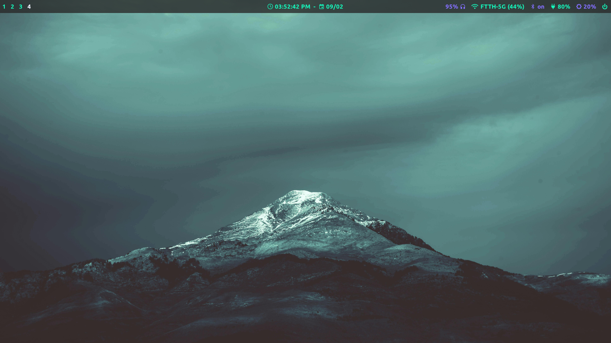

# README

## Screenshots



## Wifi connect

```
nmcli device wifi connect <SSID> --ask
```

## Update Mirrors

```
sudo pacman -S reflector
```

```
sudo cp /etc/pacman.d/mirrorlist /etc/pacman.d/mirrorlist.bak
```

```
sudo reflector --verbose --country 'India' --sort rate --save /etc/pacman.d/mirrorlist
```

## ZSH setup

Install zsh

```
sudo pacman -S zsh
```

Install oh-my-zsh

```
sh -c "$(curl -fsSL https://raw.githubusercontent.com/ohmyzsh/ohmyzsh/master/tools/install.sh)"
```

```
git clone https://github.com/zsh-users/zsh-autosuggestions.git $ZSH_CUSTOM/plugins/zsh-autosuggestions
```

```
git clone https://github.com/zsh-users/zsh-syntax-highlighting.git $ZSH_CUSTOM/plugins/zsh-syntax-highlighting
```

### Clone the repo

```
git clone --bare https://github.com/govtx86/hyprland-dotfiles.git $HOME/.cfg
```

Add the alias (in zsh shell)

```
echo "alias dot='/usr/bin/git --git-dir="$HOME/.cfg/" --work-tree="$HOME"'" >> ~/.zshrc
```

Apply the dotfiles

```
dot checkout -f
```

```
dot config --local status.showUntrackedFiles no
```

## Programs

### Hyprland

```
sudo pacman -S git curl hyprland base-devel ghostty nemo rofi-wayland neovim firefox rofi-emoji wtype
```

The configs are in `.config/hpyr/hyprland.lua`

### Yay setup

```
git clone https://aur.archlinux.org/yay-bin.git
```

```
cd yay-bin
makepkg -si
```

### Essential Programs

```
sudo pacman -S polkit-kde-agent ly xdg-desktop-portal-hyprland swaync waybar hyprpaper cliphist grim slurp swaylock playerctl pavucontrol brightnessctl ttf-firacode-nerd noto-fonts-emoji ttf-ubuntu-nerd libnotify wl-clipboard easyeffects otf-font-awesome
```
```
sudo systemctl enable ly@tty2.service
```

```
yay -S visual-studio-code-bin
```

```
mkdir -p ~/Pictures/Screenshots
```

### Additional Programs

```
sudo pacman -S htop fastfetch
```

```
yay -S cava
```

Set gtk dark theme

```
yay -S gnome-themes-extra-gtk2 adwaita-qt5-git adwaita-qt6-git numix-icon-theme-git
```
```
gsettings set org.gnome.desktop.interface color-scheme 'prefer-dark'
gsettings set org.gnome.desktop.wm.preferences theme "Adwaita-dark"
gsettings set org.gnome.desktop.interface gtk-theme "Adwaita-dark"
gsettings set org.gnome.desktop.interface icon-theme "Numix"
```

### Media apps

```
sudo pacman -S vlc vlc-plugins-all gwenview
```

### Disable recent files
```
dconf write /org/gnome/desktop/privacy/remember-recent-files false
```
```
dconf write /org/cinnamon/desktop/privacy/remember-recent-files false
```

### Bluetooth setup

```
sudo pacman -S blueman
```

Start and enable bluetooth
```
sudo systemctl enable --now bluetooth.service
```

### Nvidia driver enable

Install drivers
```
sudo pacman -S nvidia-open-dkms nvidia-utils
```

Enable DRM modeset by creating file `/etc/modprobe.d/nvidia.conf` containing:
```
options nvidia_drm modeset=1 fbdev=1
```
​
Blacklist Nouveau drivers by creating file `/etc/modprobe.d/blacklist.conf` containing:

```
blacklist nouveau
options nouveau modeset=0
```
Install Linux headers
```
sudo pacman -S linux-headers
```
Then run `sudo mkinitcpio -P` and reboot.

Verify with `lsmod | grep nvidia` and look for nvidia_drm and check with `nvidia-smi`.


### Disable nvidia gpu when not active

```
sudo pacman -S --needed nvidia-prime
```
Create the following files

`system/nvidia-pm.conf`
```
options nvidia NVreg_DynamicPowerManagement=0x02
```

`system/80-nvidia-pm.rules`
```
ACTION=="bind", SUBSYSTEM=="pci", ATTR{vendor}=="0x10de", ATTR{class}=="0x030000", TEST=="power/control", ATTR{power/control}="auto"
ACTION=="bind", SUBSYSTEM=="pci", ATTR{vendor}=="0x10de", ATTR{class}=="0x030200", TEST=="power/control", ATTR{power/control}="auto"
ACTION=="unbind", SUBSYSTEM=="pci", ATTR{vendor}=="0x10de", ATTR{class}=="0x030000", TEST=="power/control", ATTR{power/control}="on"
ACTION=="unbind", SUBSYSTEM=="pci", ATTR{vendor}=="0x10de", ATTR{class}=="0x030200", TEST=="power/control", ATTR{power/control}="on"
ACTION=="add|bind", SUBSYSTEM=="pci", ATTR{vendor}=="0x10de", ATTR{class}=="0x040300", ATTR{power/control}="auto"
```

Run the following command after creating the above files in the same folder
```
sudo install -m 644 nvidia-pm.conf /etc/modprobe.d/nvidia-pm.conf
sudo install -m 644 80-nvidia-pm.rules /etc/udev/rules.d/80-nvidia-pm.rules
```


`/etc/environment`
```
AQ_DRM_DEVICES=/dev/dri/by-path/pci-0000:00:02.0-card
__EGL_VENDOR_LIBRARY_FILENAMES=/usr/share/glvnd/egl_vendor.d/50_mesa.json
__GLX_VENDOR_LIBRARY_NAME=mesa
```

Run the following commands
```
sudo systemctl disable --now nvidia-powerd 2>/dev/null || true
sudo systemctl mask nvidia-powerd
sudo udevadm control --reload
sudo mkinitcpio -P
```

`reboot` to finish setup.

Verify using the following
```
cat /sys/bus/pci/devices/0000:01:00.0/power/runtime_status
cat /sys/bus/pci/devices/0000:01:00.1/power/runtime_status
```

### Git setup

```
git config --global user.name "username"
git config --global user.email "email"
git config --global init.defaultBranch main
```

Github auth

```
sudo pacman -S github-cli
gh auth login
```

### ASUS control

```
yay -S rog-control-center
```

```
yay -S supergfxctl
```

```
sudo systemctl enable supergfxd
sudo systemctl start supergfxd
supergfxctl --mode Hybrid
```

### Battery charge limit

```
sudo pacman -S tlp
```

```
sudo systemctl enable tlp
sudo systemctl start tlp
```

Edit(sudo) `/etc/tlp.conf` and add

```
STOP_CHARGE_THRESH_BAT0=80
```

Restart tlp service

### Add windows to GRUB

```
sudo pacman -S os-prober
```

```
sudo nvim /etc/default/grub
```

Set

```
GRUB_DISABLE_OS_PROBER="false"
```

```
sudo grub-mkconfig -o /boot/grub/grub.cfg
```

### Disable hibernation

Fixed wifi disconnect on lid close

```
sudo nvim /etc/systemd/logind.conf
```

Set

```
HandlePowerKey=ignore
HandleLidSwitch=ignore
HandleLidSwitchExternalPower=ignore
HandleLidSwitchDocked=ignore
```

### Fix mDNS

```
sudo pacman -S avahi nss-mdns
```
```
sudo systemctl enable --now avahi-daemon
```
Edit `/etc/nsswitch.conf` with sudo
Change the line:
```
hosts: mymachines resolve [!UNAVAIL=return] files myhostname dns
```
To:
```
hosts: mymachines mdns_minimal resolve [!UNAVAIL=return] files myhostname dns
```
### Setup Secure Boot
```
sudo pacman -S sbctl
```
```
sbctl status
```
Make sure secure boot is in setup mode
```
sbctl create-keys
```
```
sbctl enroll-keys -m
```
Sign all files using `sbctl sign -s` from the output:
```
sbctl verify
```
Automatic signing with the pacman hook
```
sbctl sign -s -o /usr/lib/systemd/boot/efi/systemd-bootx64.efi.signed /usr/lib/systemd/boot/efi/systemd-bootx64.efi
```
Setup Grub
```
sudo grub-install --target=x86_64-efi --efi-directory=/boot --bootloader-id=GRUB --modules="tpm all_video boot btrfs cat chain configfile echo efifwsetup efinet ext2 fat font gettext gfxmenu gfxterm gfxterm_background gzio halt help hfsplus iso9660 jpeg keystatus loadenv loopback linux ls lsefi lsefimmap lsefisystab lssal memdisk minicmd normal ntfs part_apple part_msdos part_gpt password_pbkdf2 png probe reboot regexp search search_fs_uuid search_fs_file search_label sleep smbios squash4 test true video xfs zfs zfscrypt zfsinfo" --disable-shim-lock
```
```
sudo grub-mkconfig -o /boot/grub/grub.cfg
```
Check status to verify secure boot works